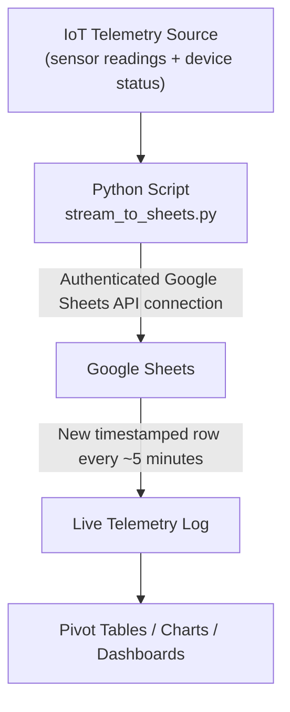

# 📡 IoT Telemetry Streaming to Google Sheets

A Python project that streams live IoT telemetry data into **Google Sheets** in near real time. The script authenticates with the Google Sheets API and appends a timestamped row of sensor readings roughly every 5 minutes, turning a spreadsheet into a lightweight live data log that can feed pivot tables, charts and dashboards.

---

## 📑 Table of Contents

- [Project Overview](#-project-overview)
- [Architecture & Data Workflow](#-architecture--data-workflow)
- [Live Output](#-live-output)
- [Data Schema](#-data-schema)
- [Features](#-features)
- [Skills & Technologies](#-skills--technologies)
- [Repository Structure](#-repository-structure)
- [Getting Started](#-getting-started)
- [Resume Highlights](#-resume-highlights)

---

## 📌 Project Overview

IoT devices generate continuous streams of readings, but they need somewhere to land. This project demonstrates a simple, low-cost approach: a Python script pushes telemetry directly into Google Sheets, where the data is immediately available for sharing, analysis and visualization without standing up a database.

---

## 🏗 Architecture & Data Workflow



---

## 🖥 Live Output

Running the script confirms the connection to Google Sheets, then logs every row as it is appended:

```
C:\Users\Guest PC\Desktop\IoT Project>py stream_to_sheets.py
Successfully connected to Google Sheets! Pushing telemetry data...
[2026-10-22 07:53:54] Appended row: [21.33, 52.75, 'Active', '2026-10-22 07:53:54']
[2026-10-22 07:54:00] Appended row: [22.03, 45.0, 'Active', '2026-10-22 07:58:55']
[2026-10-22 07:54:05] Appended row: [24.81, 69.28, 'Active', '2026-10-22 07:63:57']
[2026-10-22 07:54:11] Appended row: [27.66, 57.69, 'Active', '2026-10-22 07:68:59']
...
```


---

## 🗂 Data Schema

Each appended row contains four fields:

| Column | Example | Description |
|--------|---------|-------------|
| 1 | `21.33` | Temperature (°C) |
| 2 | `52.75` | Humidity (%) |
| 3 | `Active` | Device status |
| 4 | `2026-10-22 07:53:54` | Timestamp of the reading |

> ✏️ _Update the column descriptions to match your actual sensors._

---

## ✨ Features

- **Authenticated API connection** to Google Sheets with a startup confirmation message
- **Continuous streaming** of new rows at a regular interval (about every 5 seconds)
- **Timestamped records** for time-series analysis
- **Console logging** of every appended row for easy monitoring and debugging
- **Analysis-ready output**: data lands in a sheet that can be charted or connected to Looker Studio

---

## 🛠 Skills & Technologies

| Area | Details |
|------|---------|
| **Programming** | Python |
| **APIs & Cloud** | Google Sheets API, Google Cloud service account authentication |
| **IoT & Data Ingestion** | Real-time telemetry streaming, timestamped data logging |
| **Tools** | Google Sheets, Windows CMD |

---

## 📁 Repository Structure

```
.
├── README.md
├── stream_to_sheets.py        # Telemetry streaming script
├── requirements.txt           # Python dependencies
├── images/
│   └── Script_to_GSheets.png  # Terminal output screenshot
└── .gitignore                 # Must exclude credentials.json
```

---

## 🚀 Getting Started

### Prerequisites
- Python 3.8+
- A Google Cloud project with the **Google Sheets API** enabled
- A service account with a downloaded credentials JSON file

### Setup

1. **Clone the repository**
   ```bash
   git clone https://github.com/TatendaChuru/iot-google-sheets-streaming
   ```

2. **Install dependencies**
   ```bash
   pip install -r requirements.txt
   ```

3. **Configure access**
   - Place your service account credentials file in the project folder (e.g. `credentials.json`).
   - Share your target Google Sheet with the service account's email address, with Editor access.

4. **Run the script**
   ```bash
   py stream_to_sheets.py
   ```
   You should see `Successfully connected to Google Sheets! Pushing telemetry data...` followed by a new row every few seconds.

> ⚠️ **Never commit your credentials file.** Add `credentials.json` to `.gitignore` before your first push.

---

## 💼 Resume Highlights

- Built a Python script that streams live IoT telemetry into Google Sheets via the Sheets API, appending timestamped sensor readings every ~5 minutes.
- Implemented authenticated cloud API connections using a Google Cloud service account, with console logging for real-time monitoring.
- Turned Google Sheets into a lightweight real-time data sink, enabling downstream analysis with pivot tables and dashboards without a dedicated database.

---

## 📄 License

This project is licensed under the MIT License. See the [LICENSE](LICENSE) file for details.
